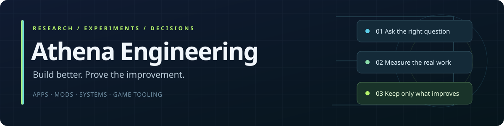

<!-- Athena managed engineering page. Original source and revision are retained in migration/engineering-atlas. -->
# Athena Engineering

### Better architecture. Better code. Measured results.

A research home for building apps, mods, programs and game tooling. **Reviewed foundation: October 26, 2026; latest contribution: November 2, 2026.** Current methods are evaluated against the actual workload; newest is not automatically best.

> A substantial improvement must change the user's end-to-end experience without discarding required behavior, checks or results.

## Best choices, avoid guidance and measured results

[Ranked recommendations](https://github.com/Herbertofury/Athena/wiki/Engineering-Ranked-Recommendations) brings together the current shortlist, a real three-library JSON experiment, 2026 papers and Codeberg-linked methods. Rankings state their workload and disqualifiers.

## Choose your route

| Area | Start here | What you get |
|---|---|---|
| 🧭 Architecture | [Technology stacks](https://github.com/Herbertofury/Athena/wiki/Engineering-Technology-Stacks) | Conditional choices and disqualifying constraints |
| 🧠 Algorithms | [Algorithms and storage](https://github.com/Herbertofury/Athena/wiki/Engineering-Algorithms-and-Storage) | Reduce repeated work without changing semantics |
| ⚡ Performance | [Performance engineering](https://github.com/Herbertofury/Athena/wiki/Engineering-Performance-Engineering) | Bottleneck diagnosis and equivalent-work experiments |
| 🗂️ Files & workers | [File pipelines](https://github.com/Herbertofury/Athena/wiki/Engineering-File-Pipelines-and-Workers) | Safe bounded concurrency and 4/8/16/32/64 worker sweeps |
| 🖥️ Desktop | [Desktop applications](https://github.com/Herbertofury/Athena/wiki/Engineering-Desktop-Applications) | Process boundaries, input stability and installed-app QA |
| 🔐 Web | [Web and security](https://github.com/Herbertofury/Athena/wiki/Engineering-Web-and-Security) | Identity, authorization and server/static boundaries |
| 🧩 Modding | [Mod development](https://github.com/Herbertofury/Athena/wiki/Engineering-Mod-Development) | Version-pinned compatibility and native proof |
| 🎨 Game assets | [Assets and animation](https://github.com/Herbertofury/Athena/wiki/Engineering-Game-Assets-and-Animation) | Separate art, mesh, motion, export and gameplay gates |
| 🧪 Shipping | [Testing and releases](https://github.com/Herbertofury/Athena/wiki/Engineering-Testing-and-Releases) | Retained failures, reproducibility and deployed-artifact verification |

## Archive and change-tracking deep dive

[Archive indexing and trustworthy change tracking](https://github.com/Herbertofury/Athena/wiki/Engineering-Archives-and-Change-Tracking): eliminate repeated parsing, bound independent readers, and recover honestly from lost filesystem events.

## Research desk

[Experiment evidence directory](https://github.com/Herbertofury/Athena/wiki/Engineering-Experiment-Evidence) groups collection, card, storage, parser and recovery studies with raw results, failures and remaining acceptance gates.

[Research method](https://github.com/Herbertofury/Athena/wiki/Engineering-Research-Method) · [Primary-source library](https://github.com/Herbertofury/Athena/wiki/Engineering-Research-Library) · [Research roadmap](https://github.com/Herbertofury/Athena/wiki/Engineering-Research-Roadmap) · [October 26 review](https://github.com/Herbertofury/Athena/blob/main/engineering/research/2026-10-26.md)

**Evidence ladder:** primary documented → hypothesis → measured → accepted in a named target. Rejected and superseded approaches stay documented. The dated primary-source register grows with each reviewed investigation; it is not an exhaustive review of every field.

## Tools you can use

- [Worker-sweep screening tool](https://github.com/Herbertofury/Athena/blob/main/engineering/docs/worker-sweep-tool.md): compare 4/8/16/32/64 with output-equivalence and explicit resource/UX budgets; no automatic default changes.

- [Paired benchmark comparator](https://github.com/Herbertofury/Athena/blob/main/engineering/scripts/compare_benchmarks.py): refuses mismatched output, workload, environment or test conditions.
- [Source/link checker](https://github.com/Herbertofury/Athena/blob/main/engineering/scripts/check_research.py): checks metadata and local structure, not external truth.
- [Experiment template](https://github.com/Herbertofury/Athena/blob/main/engineering/templates/experiment.md) · [Decision template](https://github.com/Herbertofury/Athena/blob/main/engineering/templates/decision.md).
- [Benchmark input contract](https://github.com/Herbertofury/Athena/blob/main/engineering/docs/benchmark-format.md).

Synthetic fixtures exercise the tools. They are not real application performance results. Private traces and credentials do not belong in this public atlas.

[Repository](https://github.com/Herbertofury/Athena/tree/main/engineering) · [Contribution rules](https://github.com/Herbertofury/Athena/blob/main/engineering/CONTRIBUTING.md)

## Collection and real-media laboratory

[Site adapters](https://github.com/Herbertofury/Athena/wiki/Engineering-Site-Adapters) provides dedicated platform workbenches, access boundaries and reuse candidates. [Browser card experiments](https://herbertofury.github.io/Athena/engineering/docs/card-lab/) and the [Rust lab](https://github.com/Herbertofury/Athena/tree/main/engineering/apps/atlas-lab) preserve complete outputs, failed evidence and measured tradeoffs. Real-media acceptance is separate from metadata and generated-rendering tests.

## Research Explorer and the 2026 test queue

[Search and filter the research catalog](https://herbertofury.github.io/Athena/#research): 283 candidates, including 36 papers, across 20 stack layers and 18 fields, with dated primary sources, conditional shortlists and adoption gates. Search, filter, compare and export while keeping popularity, community reports and measured cohorts separate. The consolidated queue contains 38 planned comparisons and zero approved community reports in the reviewed snapshot.

[Explorer guide](https://github.com/Herbertofury/Athena/wiki/Engineering-Research-Explorer) · [2026 research radar](https://github.com/Herbertofury/Athena/wiki/Engineering-Research-Radar-2026) · [Planned test queue](https://github.com/Herbertofury/Athena/wiki/Engineering-Research-Test-Queue) · [Community reports](https://github.com/Herbertofury/Athena/wiki/Engineering-Research-Community)

## November 2 contribution prepared

The locally validated contribution expands the catalog to **300 candidates, 40 papers and 44 planned comparisons**, and adapter coverage to **476 canonical scopes**. Repository and Explorer publication is pending; those prepared totals are not the live totals above. The package includes new Discourse and Mastodon parsers and an offline HTTP revalidation policy lab.

The first reviewed wiki pages are available: [2026 extraction methods](https://github.com/Herbertofury/Athena/wiki/Engineering-Adapter-Engineering-Methods-2026), [Discourse](https://github.com/Herbertofury/Athena/wiki/Engineering-Adapter-Discourse), [Mastodon](https://github.com/Herbertofury/Athena/wiki/Engineering-Adapter-Mastodon), and [round-four methods](https://github.com/Herbertofury/Athena/wiki/Engineering-Adapter-Methods-Round-Four). Their new repository-source links become available when the prepared contribution is published. Synthetic policy checks, retained public replays and proposed performance experiments remain distinct.
